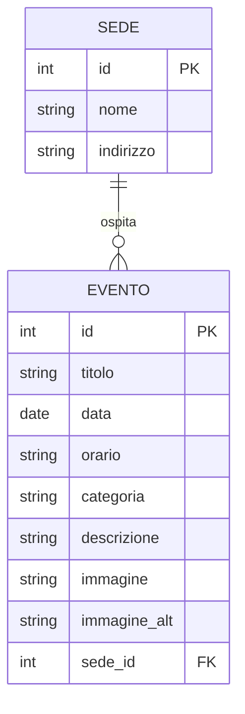

# Scheda dati — Festival Segnale

## 1. Entità

Il sistema dei dati è composto da due entità:

- **Evento**: rappresenta un'attività del festival, come un incontro, un laboratorio o una mostra.
- **Sede**: rappresenta il luogo fisico in cui si svolge un evento.

## 2. Campi delle entità

### Evento

| Campo | Tipo | Esempio |
|---|---|---|
| `id` | Numero intero | `1` |
| `titolo` | Stringa | `"Lettere in movimento"` |
| `data` | Data (AAAA-MM-GG) | `"2026-06-12"` |
| `orario` | Stringa (HH:MM) | `"10:00"` |
| `categoria` | Stringa | `"Incontro"` |
| `descrizione` | Stringa | `"Come cambia un messaggio quando cambiano le lettere?"` |
| `immagine` | Stringa (percorso file) | `"assets/lettere-in-movimento.svg"` |
| `immagine_alt` | Stringa | `"Lettere geometriche disposte su una griglia"` |
| `sede_id` | Numero intero | `1` |

### Sede

| Campo | Tipo | Esempio |
|---|---|---|
| `id` | Numero intero | `1` |
| `nome` | Stringa | `"Officina Nord — Sede centrale"` |
| `indirizzo` | Stringa | `"Corso Duca degli Abruzzi 24, Torino"` |

## 3. Chiavi primarie

Entrambe le entità hanno come chiave primaria il campo `id`.

- `Evento.id`: numero intero, univoco tra gli eventi e stabile nel tempo.
- `Sede.id`: numero intero, univoco tra le sedi e stabile nel tempo.

Gli identificativi permettono di distinguere ogni elemento e collegare gli eventi alle rispettive sedi.

## 4. Relazione tra le entità

La relazione tra Evento e Sede è di tipo **uno-a-molti (1:N)**:

- Una sede può ospitare più eventi.
- Ogni evento si svolge in una sola sede.
- Il campo `Evento.sede_id` contiene il riferimento a `Sede.id`.

## 5. Quantità dei dati

Il database del festival contiene:

- **6 eventi**
- **3 sedi**

## 6. Aggiornamento dei dati

I dati vengono aggiornati da chi gestisce il sito, modificando i file `eventi.json` e `sedi.json` all'interno della repository del progetto.

Dopo aver salvato le modifiche, i file vengono pubblicati attraverso il sistema di pubblicazione della repository, così da rendere disponibili i dati aggiornati sul sito.

## 7. Cosa mostra la pagina

La pagina Programma mostra i sei eventi del festival, organizzati per data e orario, con titolo, categoria, descrizione e immagine.

La pagina Info e luoghi presenta le tre sedi del festival, i relativi indirizzi, una galleria fotografica e una mappa per individuarle.

## 8. Schema della relazione Evento–Sede

